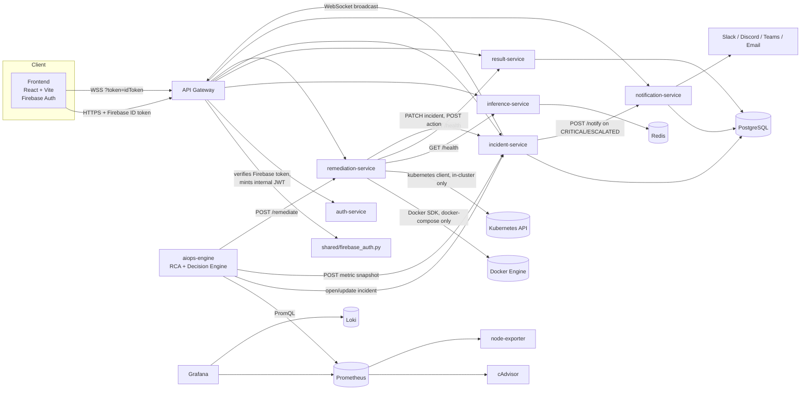
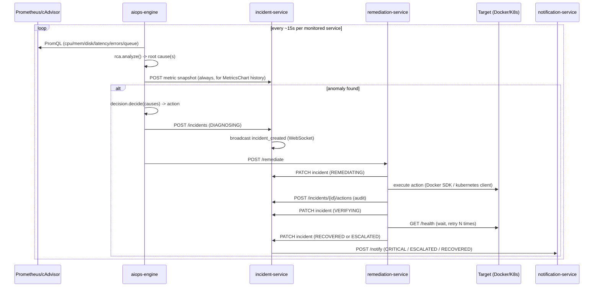

# Architecture

## System overview



## Why this shape

**One trust boundary, not eleven.** Only the frontend and API Gateway are
meant to be externally reachable (`docker-compose.prod.yml` / the
Kubernetes manifests enforce this — everything else has no public
port/Ingress). The gateway is where Firebase ID tokens get verified and
translated into an internal JWT (`shared/firebase_auth.py` +
`mint_internal_token()` in `api-gateway/main.py`) — every downstream
service keeps trusting that internal JWT exactly as before, so adding
Firebase didn't require touching nine other services.

**Self-prefixed vs. root-mounted services.** `incident-service` keeps its
own `/incidents` prefix in its route definitions (so hitting it directly on
port 8003 for its Swagger docs reads naturally); `result-service`,
`remediation-service`, and `notification-service` mount at root and rely on
the gateway's path prefix to route to them. The gateway has to know which
convention each backend uses — see the comment on `route_incidents` in
`api-gateway/main.py` for the bug this caused when it assumed one
convention for both (fixed).

**Docker locally, Kubernetes for real remediation.** `remediation-service`
talks to whichever backend is actually available:
`docker.from_env()` when running under Compose (mounts
`/var/run/docker.sock`), or the Kubernetes Python client's
`load_incluster_config()` when running as a pod with the
`remediation-service` ServiceAccount (`infra/kubernetes/base/01-rbac.yaml`).
Same code path, same decision engine — only the executor backend changes
based on where it's deployed. `ENABLE_KUBERNETES_REMEDIATION` stays `false`
by default even inside a cluster, on purpose — it's a switch you flip after
confirming the RBAC actually grants what you expect, not an assumption baked
into the deployment.

**Every write is auditable.** `incident-service` owns four tables that
exist specifically for this: `incidents` (current state),
`incident_events` (the DETECTED→RCA→REMEDIATION→VERIFICATION→RESOLVED
timeline), `actions` (every concrete Docker/K8s action remediation-service
took, independent of the incident's own summary field), and `audit_logs`
(who — human `sub` claim or `internal-service` — did what, when).

## Data model (incident-service, PostgreSQL)

```mermaid
erDiagram
    INCIDENTS ||--o{ INCIDENT_EVENTS : has
    INCIDENTS ||--o{ ACTIONS : has
    INCIDENTS {
        int id PK
        string incident_uid
        datetime timestamp
        string service_name
        string severity
        float anomaly_score
        jsonb metrics
        string root_cause
        string recommended_action
        string executed_action
        string recovery_status
        datetime resolved_time
    }
    INCIDENT_EVENTS { int id PK; int incident_id FK; string stage; text message; datetime created_at }
    ACTIONS { int id PK; int incident_id FK; string action_type; string target; string backend; string mode; string result }
    METRIC_SNAPSHOTS { int id PK; string service_name; float cpu_percent; float memory_percent; float latency_ms; float error_rate_percent }
    AUDIT_LOGS { int id PK; string actor; string action; int incident_id; text detail }
    NOTIFICATIONS { int id PK; int incident_id; string channel; bool sent; text reason }
```

## Self-healing sequence



## Deployment topologies

Three, all from the same source tree — see `docs/how-to-run.md`:

1. **`docker-compose.yml`** — local dev, every port published, fastest
   iteration loop.
2. **`docker-compose.prod.yml`** — single public entry point (`edge`,
   nginx), everything else internal-only. Docker-based remediation.
3. **`infra/kubernetes/`** (Kustomize, `base` + `region-a`/`region-b`
   overlays) — same nine services + Postgres/Redis as real K8s workloads,
   RBAC-scoped remediation via the Kubernetes API instead of the Docker
   socket. Designed for `kind`/`minikube` first (per the project's own
   research-reproducibility requirement — no cloud dependency to run the
   experiments), cloud deployment (`infra/terraform`) is optional on top.

